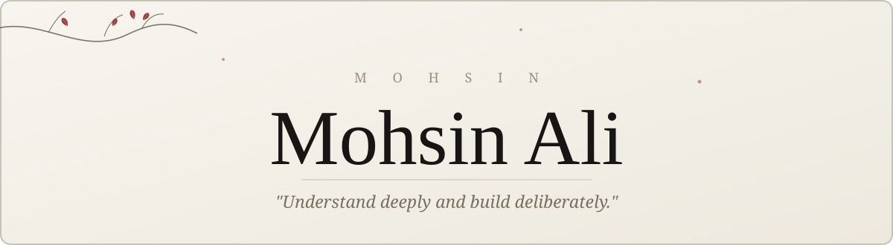

 

 

&nbsp;

&nbsp;

 

`─────────  T H E   A R S E N A L  ─────────`

> **⌂ languages** — the languages I use to learn and build.

> **⌂ the laboratory** — exploring artificial intelligence and experimentation.

> **⌂ the environment** — the tools behind my work.

 

`─────────  T H E   W O R K  ─────────`

<table>
<tr>
<td width="50%" valign="top">

**⚒ [CoreLMS](https://github.com/OneTime24/Project_Semester2)**

An object-oriented Learning Management System built as a university project.

`C++` — `OOP`

</td>
<td width="50%" valign="top">

**⚒ [PersonalOS](https://github.com/OneTime24/PersonalOS)**

A personal productivity workspace developed as a frontend project.

`JavaScript` — `Web Development`

</td>
</tr>
<tr>
<td width="50%" valign="top">

**⚒ [College Environment](https://github.com/OneTime24/College_environment)**

An experimental AI-powered college assistant featuring local AI models and voice interaction.

`Python` — `AI` — `Voice Interaction`

</td>
<td width="50%" valign="top">

**⚒ Plagiarism Checker**

A document and source-code similarity checker using 3-gram analysis and the Dice coefficient.

`C` — `Algorithms` — `File Processing`

</td>
</tr>
</table>

 

`─────────  T H E   J O U R N E Y  ─────────`

> **NOW** — Computer Science undergraduate at FAST-NUCES, Peshawar.

> **EXPLORING** — Artificial Intelligence, cybersecurity and computer science research.

> **BUILDING TOWARDS** — Strong foundations, meaningful research and graduate studies.

 

`─────────  T H E   G R I N D  ─────────`

 

&nbsp;
  

  

<a href="https://github.com/OneTime24">GitHub</a>
&nbsp;·&nbsp;
<a href="https://www.linkedin.com/in/mohsin-ali-177885260/">LinkedIn</a>

  

⚒ &nbsp; *Understand deeply. Build deliberately. Keep going.* &nbsp; ⚒

